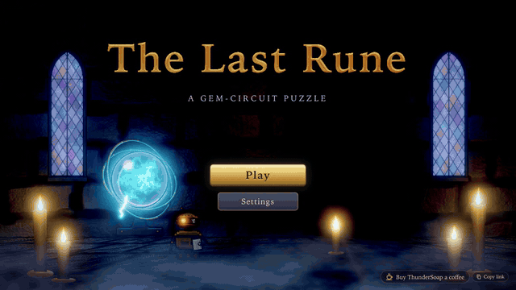

# ThunderClap Engine

A WebGPU game engine for the browser, written in TypeScript. It renders 2D and 3D with raw WebGPU, runs on desktop, tablet, phone and VR headsets, and has no runtime dependencies.

`@thunderclap/engine` knows nothing about any game. A game supplies its scenes, rules and art; the engine supplies the canvas, the frame loop, rendering, post-processing, input, UI, audio, saves and the page lifecycle.

<p align="center">
  
  <br />
  <sub><a href="https://mandalorian007.github.io/last-rune/">The Last Rune</a>, the first game built on ThunderClap</sub>
</p>

**Vision:** [docs/VISION.md](docs/VISION.md) says what ThunderClap is for and where it is going.

## Contents

- [Features](#features)
- [Requirements](#requirements)
- [Quick start](#quick-start)
- [Guides](#guides)
- [Modules](#modules)
- [How a frame runs](#how-a-frame-runs)
- [Baking](#baking)
- [Testing](#testing)
- [Design rules](#design-rules)
- [Status and roadmap](#status-and-roadmap)
- [Built with ThunderClap](#built-with-thunderclap)
- [License](#license)

## Features

Each line names where to start. [docs/OFFERING.md](docs/OFFERING.md) has the longer list.

**Start and run**

- **One boot call.** Canvas, renderer, post, particles, input, overlay, audio, save, host and a fixed 60 Hz loop in one ctx: `createGame(opts)`.
- **Client mode** for a server-authoritative game: no save, the loop runs once per rendered frame: `createGame({ sim: false })`, `ctx.hooks.frame`.
- **Every page it runs in.** A top-level tab, a cross-origin iframe (itch.io), Electron, Capacitor and an installable PWA: `Host`, `createWebHost`, `@thunderclap/host-electron`, `@thunderclap/host-capacitor`, `@thunderclap/host-pwa`.
- **Page lifecycle.** Hiding stops the loop and flushes the save; device loss shows a reload screen: `ctx.hooks.hide`, `ctx.hooks.deviceLost`.

**Render**

- **2D and 3D on one renderer.** HDR colour and emissive targets, instanced sprites and meshes, one instance format: `frame.sprite`, `frame.mesh`, `Transform`.
- **Cameras.** `Camera.ortho2d` by default, `Camera.perspective` with depth, split views and stereo: `renderer.render(frame, camera, target)`.
- **Materials in your own WGSL.** A prelude gives you the lights, shadow and fog: `renderer.createMaterial({ label, wgsl })`, `materialPrelude`.
- **Lights, shadows and fog.** Ambient, a sun with a shadow map, 16 point and 8 spot lights, layer masks: `frame.lights`.
- **PBR.** The glTF metallic-roughness material, with normal maps and skinning: `createStandardMaterial`.
- **Skinning.** GPU skinning in the scene and shadow passes: `VERTEX_LAYOUT_SKINNED`, `SkinPalette`.
- **LOD and culling.** Per-mesh bounds, frustum culling and level selection by screen size: `mesh.bounds`, `MeshLod`, `selectLod`, `InstanceList`.
- **2D kit.** Tile layers, flipbooks, parallax and a follow camera: `createTileLayer`, `Flipbook`, `createParallax`, `createFollow2D`.
- **Textures.** Images, texture arrays with GPU mips, KTX2: `loadTexture`, `loadTextureArray`, `uploadKtx2`.

**Post and FX**

- **Post stack.** Bloom, tone map, grade, vignette, god rays, fog, AO, depth of field, TAA, SSR, motion blur, auto exposure and finishing passes, with quality tiers: `ctx.post` (`PostStack`), `postQualityFor`.
- **GPU particles.** 2D or world space, soft, lit, with sprite sheets, forces, collision and effect files: `ParticleSystem`, `createEffect`.
- **World FX.** Sky, water, trails, decals, billboards and debug lines: `Sky`, `Water`, `Trail`, `Decals`, `createBillboards`, `createDebugDraw`.

**Content**

- **glTF 2.0.** Meshes, materials, skins, animations, morph targets and common extensions: `parseGltf`, `loadGltf`.
- **Typed asset loading.** A manifest, a progress bar and a cache: `defineManifest`, `createBundle`, `createAssetCache`, `packAtlas`.
- **Procedural geometry.** Boxes, spheres, capsules, heightfields and more: `box`, `sphere`, `createHeightfield` in `@thunderclap/engine/geom`.
- **Collision.** A static collider and capsule or circle sliding: `createStaticCollider`, `slide`, `slide2`.
- **Voxel worlds.** Greedy-meshed chunks with baked AO from a Worker, culled per chunk, with a block-picking ray: `createVoxelGrid`, `createVoxelChunks`, `raycastVoxels`.
- **Navigation.** Grids, navmeshes, A*, flow fields and crowds: `createNavGrid`, `findPath`, `bakeNavMesh`, `createCrowd`.
- **Animation.** Clips, a mixer, an animation graph, IK, retargeting and springs: `AnimationMixer`, `createAnimGraph`, `twoBoneIk`, `retargetPose`.
- **Sockets.** A transform that follows a joint, for hats and swords: `attachTransform`.
- **Tweens.** Easing, sequences and springs: `createTweens`.

**Input**

- **One action map** over keyboard, mouse, touch, pen and gamepad: `createGame({ input: { bindings } })`, `ctx.input.pressed`.
- **Gestures.** Tap, double tap, long press, pan, drag and pinch, and a loupe for small targets: `ctx.gestures`, `input.magnify`.
- **Picking.** Every pointer is a ray; test it against planes, boxes or meshes: `ctx.pointers`, `meshTester`.
- **First and third person.** Pointer lock, touch zones, sticks and a follow camera: `createLook`, `Follow`, `createTouchZones`.
- **Record and replay.** Record a session and run it back tick for tick: `createGame({ input: { record, replay } })`, `ctx.replay(rec)` mid-session, `createInputPlayback`.
- **WebXR.** Enter VR, render each eye through the post stack, controllers and hands as rays: `createGame({ xr })`, `ctx.xr.enter()`.

**UI, audio and plumbing**

- **DOM overlay in layout regions** for phone, tablet and desktop, with safe areas and text scale: `ctx.ui`, `ctx.ui.layout`, `LayoutSpec`.
- **HUD widgets.** Meters, orbs, rings, a compass, a minimap, a reticle, slots and floating numbers: `ui.meter`, `createOrbMeter`, `ui.minimap`, `ui.floats`.
- **World UI.** DOM anchored to world points and panels in 3D or VR: `ui.anchors(() => camera)`, `createWorldPanel`.
- **Audio.** Buses, a synth, sound recipes, music stems, spatial voices and zones: `ctx.audio`, `createMusic`.
- **Saves.** Versioned, schema-checked slots with migrations: `createSaveStore`, `s`, `createSlotManager`.
- **Analytics.** Typed, batched events to a sink you supply: `createAnalytics`.
- **i18n.** String tables, plurals through `Intl`, a runtime locale swap: `createI18n`.

## Requirements

- A WebGPU browser: Chrome or Edge 113+, or Safari 26+ (including iOS and iPadOS).
- To develop: Node 22 or newer and pnpm (the version is pinned in `package.json`).

## Quick start

```sh
git clone https://github.com/Mandalorian007/thunderclap-engine.git
cd thunderclap-engine
pnpm install
pnpm example     # http://127.0.0.1:5173: a glowing square; click or press Space to flare it
```

To start a game of your own, pick a template and scaffold it into its own folder:

```sh
pnpm create-game --list                              # the four templates
pnpm create-game ../my-game --template platformer
cd ../my-game && pnpm install && pnpm dev
```

| Template | Start here if you want |
| --- | --- |
| `puzzle` | a 2D board game: one scene, pure rules with tests, a versioned save, a HUD laid out on every screen |
| `platformer` | a 2D action game: tile maps, a flipbook player, parallax, a follow camera, touch zones, a pause menu, sounds |
| `first-person` | a 3D world you walk through: `Look`, Worker-built chunks, a sun with shadows, fog, weather, world labels |
| `third-person` | a 3D character game: a skinned, animated hero, a follow camera, sockets, foot IK, PBR, enemies with health bars |

The new folder is a standalone project with `@thunderclap/engine` as a dependency. Each template ships a `CLAUDE.md` that names the engine concepts it uses. `--engine <spec>` points it at a local or git copy of the engine, `--dry-run` prints the plan, and a non-empty folder needs `--force`. [Getting started](docs/guide/getting-started.md) walks through the rest.

This is the whole example (`examples/hello/main.ts`):

```ts
import { createGame } from '@thunderclap/engine';
import type { Scene } from '@thunderclap/engine/core';
import { type DrawParams, type Frame, hex } from '@thunderclap/engine/render';
import { createSaveStore, s } from '@thunderclap/engine/save';

const ctx = await createGame({
  root: document.getElementById('app')!,
  title: 'Hello ThunderClap',
  save: (host) =>
    createSaveStore({
      game: 'hello',
      slot: 'main',
      version: 1,
      defaults: () => ({ flares: 0 }),
      schema: s.object({ flares: s.number() }),
      host,
    }),
  input: { bindings: { flare: [{ mouse: 0 }, { key: 'Space' }] } },
});

if (ctx) {
  // null means no WebGPU: the unsupported screen is already showing.
  const square: DrawParams = { x: 960, y: 540, w: 240, h: 240, rotation: 0, emissive: 1 };
  let glow = 1;

  const hello: Scene<typeof ctx, Frame> = {
    update(dt) {
      square.rotation = (square.rotation ?? 0) + dt;
      if (ctx.input.pressed('flare')) {
        glow = 4;
        ctx.save.update((d) => ({ flares: d.flares + 1 }));
      }
      glow += (1 - glow) * Math.min(1, dt * 3);
    },
    render(frame) {
      frame.clear(0.02, 0.02, 0.04);
      square.tint = hex('#3fe0ff', glow); // HDR tint above 1 blooms
      frame.sprite(null, square);
    },
  };

  ctx.stack.push(hello);
  ctx.loop.start();
}
```

The world is a 1920×1080 logical space by default (origin top-left, y down), scaled to fit any screen. `createGame` returns `null` when the browser has no WebGPU. A game usually widens `ctx` with its own nouns (`Object.assign(ctx, { ... })`) so every scene gets one typed ctx.

### Using it in a game

The package isn't on npm yet. It ships TypeScript source, which your bundler compiles (Vite is what it's built and tested with). `pnpm create-game` sets the dependency for you; by hand, use a workspace package or a git dependency:

```jsonc
// package.json
"dependencies": {
  "@thunderclap/engine": "github:Mandalorian007/thunderclap-engine"
}
```

Import only from the public entry points listed under [Modules](#modules). Anything not re-exported from a module's `index.ts` is internal.

## Guides

Short, task-shaped walkthroughs. Every TypeScript block in them is typechecked against the engine by `pnpm check`.

1. [Getting started](docs/guide/getting-started.md): scaffold, run, the shape of a game, and shipping to itch.io, Electron or a PWA.
2. [A 2D game](docs/guide/2d-game.md): sprites, the camera, your own WGSL, particles and layout regions.
3. [A 3D game](docs/guide/3d-game.md): perspective, meshes, glTF, lights, shadows, PBR, LOD and culling.
4. [Characters](docs/guide/characters.md): a skinned glTF, the animation mixer, sockets and the follow camera.
5. [Input](docs/guide/input.md): actions, gestures, pointer rays, `Look`, pads, touch zones, record and replay.
6. [UI and HUD](docs/guide/ui-and-hud.md): the overlay, regions, widgets, world anchors and panels, theme and text scale.
7. [Style and post](docs/guide/style-and-post.md): the post stack, quality tiers, FX, sky, water and weather.
8. [VR](docs/guide/xr.md): entering VR, controllers and hands, per-eye post, panels.
9. [Testing your game](docs/guide/testing-your-game.md): replay tests, the harness pattern and `expect.poll`.

The module READMEs under `src/<module>/` are the full reference.

## Modules

| Import | What it holds |
| --- | --- |
| `@thunderclap/engine` | `createGame(opts: CreateGameOptions)` (with `aux` for the renderer's aux targets), `EngineCtx`, `GameHooks` (with `HideReason`, `ShowReason`), `SimOption`, `FlushableSave`, `GameReplay` and `ReplayOptions` (`ctx.replay`, with `onEnd`), `XrOptions` and `XrControl` (`ctx.xr`): the top layer a game touches |
| `@thunderclap/engine/core` | `GameLoop` (fixed step, fps cap, pause, `setFrames` to swap the frame source), `Scene` and `SceneStack`, `Emitter`, `mat4`, timing ([README](src/core/README.md)) |
| `@thunderclap/engine/platform` | WebGPU boot, `Surface` (canvas, DPR, letterbox fit), `XrSurface` (a target and camera per eye), page lifecycle, device detection, the unsupported and reload screens ([README](src/platform/README.md)) |
| `@thunderclap/engine/render` | `Renderer`, `Frame`, `Camera` (`ortho2d`, `perspective`, frustum culling), `render(frame, camera, target)`, `SceneTarget`, `Lights` (sun shadow map, fog), materials and custom WGSL, meshes with bounds and streaming updates, transforms, textures and texture arrays with GPU mips, colour helpers ([README](src/render/README.md)) |
| `@thunderclap/engine/post` | `PostStack`: bloom, god rays, fog, vignette, grade, AO, DoF, finishing passes, TAA, SSR, auto exposure, white balance, motion blur, lens dirt, quality tiers ([README](src/post/README.md)) |
| `@thunderclap/engine/fx` | GPU particles (2D or world space), ribbon trails, debug line drawing, billboards with a text atlas, projected decals, sky, flicker and pulse ([README](src/fx/README.md)) |
| `@thunderclap/engine/anim` | Keyframe clips (glTF sampler semantics), `Pose`, `Skeleton`, `AnimationMixer` (layers, weights, crossfade, events), `poseToWorld`, `skinMatrices`, `twoBoneIk`, `lookAt`, root motion; pure, no GPU ([README](src/anim/README.md)) |
| `@thunderclap/engine/tween` | `createTweens()`: easing table (`ease.*`, `steps`, `cubicBezier`, `spring`), property and value tweens, sequences and parallel groups, loops, yoyo, delays, `Tweens.update(dt)`; pure, no GPU ([README](src/tween/README.md)) |
| `@thunderclap/engine/input` | `Input` action map, `Gestures`, pointer router and rays (`XrPointerSource` for controllers and hands), `Look` (pointer lock, touch zones, sticks), magnify/loupe, `snapToGrid` ([README](src/input/README.md)) |
| `@thunderclap/engine/nav` | `createNavGrid` (edge costs, 4 or 8 neighbours), `findPath` (A*) and `smoothPath`, `createFlowField` (multi-goal, in-place update), `reachable`, `followPath`, `steer`: grid navigation over XZ, pure CPU ([README](src/nav/README.md)) |
| `@thunderclap/engine/ui` | Overlay, panels and widgets, toasts, captions, pad navigation, layout regions (`ui.layout`), world anchors (`ui.anchors`) ([README](src/ui/README.md)) |
| `@thunderclap/engine/audio` | WebAudio buses, synth, sound recipes, mixer persistence, spatial voices (`audio.listener`, `PlayOptions.at`) ([README](src/audio/README.md)) |
| `@thunderclap/engine/save` | `createSaveStore`, schemas (`s`, with typed arrays), migrations, `createSlotManager`, `createSettingsStore` with `bind`, `createJournal` ([README](src/save/README.md)) |
| `@thunderclap/engine/assets` | `parseGltf` and `loadGltf` (glTF 2.0 to meshes, transforms, textures and materials), `defineManifest` and `createBundle` (typed asset loading from the game's `read`), `packAtlas` ([README](src/assets/README.md)) |
| `@thunderclap/engine/analytics` | `createAnalytics`: typed, batched events to a game-supplied sink; no network code ([README](src/analytics/README.md)) |
| `@thunderclap/engine/i18n` | `createI18n`: string tables per locale, ICU-style plurals and select through `Intl`, fallback chain, runtime locale swap with `subscribe`, `negotiateLocale` ([README](src/i18n/README.md)) |
| `@thunderclap/engine/host` | `Host` interface, `createWebHost()` (top-level page or iframe), `createXrHost(session, base)` (frames from an `XRSession`): links, clipboard, fullscreen, storage ([README](src/host/README.md)) |
| `@thunderclap/engine/voxel` | `createVoxelGrid`, `meshChunk` (greedy, baked AO), `createVoxelMesher` and `installVoxelMesherWorker` (the Worker bridge), `createVoxelChunks` (one mesh per chunk, rewritten in place, frustum-culled), `raycastVoxels`, the `VOXEL_WGSL` prelude ([README](src/voxel/README.md)) |
| `@thunderclap/engine/testing` | Test doubles for unit tests (`src/testing/index.ts`): the fake GPU, a fake host and a fixed clock |
| `@thunderclap/engine/geom` | Procedural geometry: `box`, `plane`, `sphere`, `icosphere`, `capsule`, `cylinder`, `torus`, heightfields (`heightAt`, `normalAt`, `raycastHeightfield`, `heightfieldGeometry`), `mergeGeometry`, `transformGeometry`; pure, a `Geometry` is a `MeshDesc` ([README](src/geom/README.md)) |

**Templates.** Copyable games under `templates/`, each with a `CLAUDE.md` that names the engine concepts for an agent extending it: `puzzle`, `platformer`, `first-person` and `third-person` (see [Quick start](#quick-start)). `pnpm template:<name>` runs one inside this repo. `pnpm check` runs each one's typecheck and tests and scaffolds one into a temp dir (`check:create-game`); `pnpm test:e2e` boots each on the device matrix (`e2e/templates.spec.ts`).

**Demos.** Playable showcases under `demos/` (E-021), each a page on the public API with no network assets, exposing `window.__demo` for its spec under `e2e/demos/`. `pnpm demo <name>` serves one (`pnpm demo` lists them); the harness server also serves them at `/demos/<name>/`, so the matrix runs them. [demos/README.md](demos/README.md) has the table.

**Packages.** `packages/host-electron` (`@thunderclap/host-electron`) is the Electron desktop host: a sandboxed shell, a preload bridge and `createElectronHost()`. It lives in this repo as a pnpm workspace package and the engine never imports it. Run `pnpm desktop:dev`, `pnpm desktop:build` or `pnpm test:e2e:desktop` ([README](packages/host-electron/README.md)). `packages/host-capacitor` (`@thunderclap/host-capacitor`) is the Capacitor mobile host: `createCapacitorHost()` fills `Host` from the Capacitor plugins an iOS or Android app hands in (links, clipboard, orientation lock, Preferences-backed saves, app lifecycle, haptics, the Android back button); it imports none of them, so it checks and tests in this repo without Capacitor installed (`check:host-capacitor`, [README](packages/host-capacitor/README.md)). `packages/host-pwa` (`@thunderclap/host-pwa`) is the installable web shell: `createPwaHost()` adds install, update and offline state to the web host, and `pwaPlugin` (`@thunderclap/host-pwa/vite`) emits the manifest and service worker at build time, with no dependencies. Run `pnpm pwa:dev` or `pnpm pwa:build` ([README](packages/host-pwa/README.md)).

[ARCHITECTURE.md](ARCHITECTURE.md) has the contracts for each one: what exists today and what is planned.

## How a frame runs

```
createGame()
  └─ GameLoop  (fixed 60 Hz update, variable-rate render; frames from the host: rAF, Electron, or an XRSession)
       update(dt):  input → pad nav → hooks.update → particles → scene stack
       render:      hooks.beforeRender → renderer.beginFrame → scene stack → endFrame → hooks.afterRender

renderer.endFrame()
  1. upload globals and all instance data (one writeBuffer each)
  2. pre-passes and drawable.prepare() (compute, uploads), on the first render() of the frame
  3. per render(frame, camera, target): frustum cull, sort, a sun shadow pass when lights.sun.shadow is set,
     then the scene pass → HDR colour + emissive targets (+ depth)
  4. post stack (bloom, god rays, fog, vignette, grade) → swapchain (in VR: per eye, into the
     session's layer, via renderer.resolve)
  5. submit
```

`renderer.render(frame, camera, target)` runs the recorded draw lists through a camera into a target, any number of times per frame; `endFrame` calls it with `renderer.camera` when nothing did. With the default `ortho2d` camera draw order is submission order (then `order`) and there is no depth attachment; a camera with depth sorts by view-space depth and tests depth. Consecutive draws with the same material and mesh batch into one instanced call.

## Baking

A navmesh or a static collider is a pure function of its level geometry, so bake it once at build time and ship the bytes:

```sh
pnpm bake bake.config.json             # writes <out>/<name>.navm, <out>/<name>.coll and bake-manifest.json
pnpm bake bake.config.json --check     # exit 1 when any input changed since the last bake (CI)
pnpm bake bake.config.json --watch     # rebake on change; --verbose prints sizes and times
pnpm bake:nav level.glb level.navm --options nav.json   # one source to one navmesh, no config or manifest
```

`bake.config.json` (paths relative to the file; `out` defaults to `public/baked`):

```json
{
  "out": "public/baked",
  "nav": [{ "name": "level", "sources": ["assets/level.glb"], "options": { "cellSize": 0.3, "agentHeight": 1.8, "agentRadius": 0.4 } }],
  "colliders": [{ "name": "level", "sources": ["assets/level.glb", "assets/props.json"], "options": { "leafSize": 4 } }]
}
```

A source is a `.glb`, a `.gltf` or a geometry JSON (`{ "positions": [...], "indices": [...] }`). `options` are the `NavBakeOptions` (`nav`) or `StaticColliderOptions` (`geom`) the runtime takes; a navmesh needs only `cellSize` and a bad value fails with a `NavBakeError` naming the option. The game loads the bytes with `fetch` or a `bytes` bundle entry and calls `importNavMesh` or `importCollider` (`loadNavMesh` for a `bake:nav` file). From a game's folder the script is `node node_modules/@thunderclap/engine/scripts/bake.mjs bake.config.json` (the third-person template's `pnpm bake`); it runs the engine's TypeScript through Node's type stripping, needs no build step, and its output is byte-identical between runs. The [nav reference](src/nav/README.md) has the option table.

## Testing

```sh
pnpm check       # typecheck + Biome lint + import boundaries + README coverage (check:docs) + Vitest unit tests (2383 tests in 216 files) + the host-electron, host-capacitor, host-pwa, template and create-game checks
pnpm test:e2e    # Playwright e2e against the harness pages, on a device matrix
pnpm harness     # serve the harness pages yourself
```

The e2e specs run against small harness pages that don't contain any game (`harness/`). Every spec runs on the same matrix:

- desktop at 1280×720 and 1920×1080;
- an iPad;
- four landscape phones with touch and safe-area insets;
- the harness inside a cross-origin iframe.

The layout spec also runs on upright phone and tablet rows. The pages: `index.html` (2D renderer), `game.html` (`createGame`), `ui.html` (the overlay, text scale, menus and panels, no WebGPU), `layout.html` (layout regions and safe areas on every form factor, no WebGPU), `gestures.html` (gestures and the magnify loupe, no WebGPU), `widgets.html` (the second widget set: reticle, bar, segmented, select, key prompt, stepper and cooldown on the HUD layer, no WebGPU), `rays.html` (pointer router and rays), `mesh.html` (perspective camera, depth, a shadowing sun, fog and a lit mesh orbiting under pointer and pad input; `?still` parks the lamp and the spinning blocks for pixel probes), `lights.html` (a sweeping spot light and a point light masked to one of two cubes on different layers), `zones.html` (audio zones: the camera orbits through a sphere room and a box corridor while `audio.update` drives weights, ambient gains and reverb sends, and a voice follows an orbiting cube), `pbr.html` (the standard PBR material: a metallic × roughness sphere grid and a normal-mapped tile under sun, shadow and fog), `skin.html` (skinned tubes swung by a joint palette, lit and beside a shadow caster), `views.html` (the mesh scene drawn twice per frame through two eyes, the stereo seam), `weather.html` (world-space rain, snow and lit dust over the mesh scene), `fx3.html` (the extended particle kernel over the same scene, one mode per load: `?sheet` a procedural sprite sheet and a parked spinning sprite walking its tiles, `?forces` an attractor and vortex shadowed on the CPU, `?collide` rain staying on a floating slab through depth collision, `?sub` fireworks whose children outlive their parents, `?effect` the bundled aura attached to a moving point; `?still` parks the motion), `fx4.html` (seeded effects and decals on the depth hook, one mode per load: `?seed=N` a two-system effect seeded with N, stepped 120 fixed steps, frozen and hashed from a readback, the same on every load; `?decalLag` a cube sliding under a box decal that reads this frame's depth, no decal pixel off the cube; `&copy` the previous-frame fallback, where the decal trails), `sky.html` (a procedural `Sky` over the mesh scene's ground and blocks: the sun arcing through a day, stars at night, `?still` parks it at noon), `water.html` (a `Water` surface in a basin of boxes with a ramp running into it under a `Sky`: depth fade, foam, the sun's highlight; `?still` parks the sun), `decals.html` (projected decals stamped onto a floor and two blocks by click or api; `?mode=box|quad`), `trails.html` (ribbon trails behind a swinging arm and an orbiting emitter), `tween.html` (a grid of easing curves, each with a sprite `Tweens.to` moves along it, the spring included), `anim-graph.html` (a three-joint figure of boxes driven by `createAnimGraph`: an idle/walk/run blend space on `speed` with phase sync, a `jump` state on a boolean), `look.html` (a first-person walk on `Look`: pointer lock, touch zones, sticks, WASD), `follow.html` (a third-person `Follow` camera over `Look`: orbit, shoulder, walls swinging it in, `V` for first person), `stream.html` (chunk meshes rebuilt in a Worker and uploaded without a copy, textured from a texture array and frustum-culled), `voxel.html` (a 4×2×4-chunk block world through `@thunderclap/engine/voxel`: meshed with baked AO in a Worker, culled by chunk, picked by the centre ray, a click breaks and the secondary button places, edits rewriting the chunk mesh in place; `?still` parks the sun), `anchors.html` (DOM labels and a clamped marker following cubes through `ctx.ui.anchors`), `hud.html` (the overlay's reticle, meters, slot strip and heading over the mesh scene), `gltf.html` (a GLB built in the page parsed and drawn through `@thunderclap/engine/assets`), `gltf3.html` (ws/assets-3: glTF extensions on built GLBs, a quantized cube beside its float twin with `?quant`, a meshopt rock with `?meshopt`, a scene lit by its own punctual lights through its own camera with `?lights`, material variants cycling with `?variants`, ten assets through a small `createAssetCache` budget with `?cache`; `?still` parks), `morph.html` (a generated `.gltf` sphere with squash and bulge morph targets driven by its `weights` clip through `sampleWeights` and `scene.morph(node).apply()`), `xr.html` (`createGame({ xr })` with an "Enter VR" button; on the matrix it proves the page path with `supported() === false`, on a headset it enters an immersive session), `pick.html` (six spinning meshes picked through `meshTester`: click or tap tints the hit one), `retarget.html` (two stick figures, no WebGPU: a wave clip on one rig drives a longer-limbed rig with other joint names and rotated rest frames through `retargetPose`), `sockets.html` (a mixer-driven three-joint arm with cubes attached to its joints by index and by name through `attachTransform`), `geom.html` (every `@thunderclap/engine/geom` builder turning, lit, over a heightfield ground from a sine bump map), `geom3.html` (ws/geom-3: `?lod` a rock at four distances drawn at the LOD level `selectLod` picks, `?hull` a torus beside its convex hull, `?slice` a cube cut and capped by a sweeping plane, `?tiles` a box riding a moving platform through `slideTiles`; `?still` parks), `i18n.html` (a locale switcher over `en`, `ru` and a lazily loaded `ar`, a plural counter and an RTL sample, no WebGPU), `ik.html` (a two-bone arm following an orbiting target and a head looking at it, through `twoBoneIk` and `lookAt`, no WebGPU), `save.html` (three save slots listed from their meta sidecars, a volume slider bound to a settings store, a 64×64 `Uint8Array` tilemap with undo and redo, no WebGPU), `music.html` (synth stems on a 120 bpm beat grid through `createMusic`, an intensity slider crossfading two drum stems, a footstep button on `createVariations`, a reverb send and a spoken line that ducks the music, no WebGPU), `depth-post.html` (the mesh scene, still, under screen-space ambient occlusion and depth of field; `?ao=0`, `?dof=0`), `post2.html` (a tilted flat-shaded cube over a gradient, still, with one finishing pass on: `?pass=fxaa|lut|grain|aberration|sharpen|outline`), `post3.html` (a lit mirror floor, a grey block and a bright sky patch over a dark backdrop under the post-3 passes: `?taa ?ssr ?autoexp ?wb=3200 ?mblur ?dirt`, `?still` parks the orbit), `post4.html` (the post stack on the render-4 inputs, each feature read back against a reference stack: `?taa` jittered convergence and a sliding bar's trail, `?ssr` a rough and a smooth metal floor half, `?blur` a cube swinging under a still camera, `?ortho` the AO term at two ortho zooms, `?still`), `nav.html` (a grid with a gapped wall, no WebGPU: a click sets the goal, 32 agents flow to it, a probe path is drawn after string pulling), `navmesh.html` (a level of `geom` boxes and a ramp baked into a `NavMesh` on the page and drawn with `createDebugDraw`: a click sets the goal, a path climbs the ramp or takes an off-mesh "jump down" link when it is cheaper, `?crowd=24` adds an ORCA crowd converging on the pointer), `nav4.html` (a floor and two pillars baked on the page, no WebGPU: 48 crowd agents on corridors, `&carve` dropping an obstacle between the pillars that replans them, `?queue` taking 200 requests a second through a path queue, `?areas` pricing mud, `?flow3` walking a mesh flow field; `?still`), `nav5.html` (ws/nav-5, no WebGPU: a unit's movement range on a tactics board of tiles with blocks and mud, `reachable(mesh, …)` filling the polygons in range and `reachableOutline` stroking its boundary loops, recomputed every step; `?range`, `?still`), `debug.html` (every `DebugDraw` shape in one line-list draw: axes over a grid, a spinning wire box and sphere, an arrow riding a sine path and a `path` from a static array), `billboards.html` (six capsules with name plates, health bars and rising damage numbers from one `Billboards` batch), `collide.html` (a level from the geom builders with a capsule walked by WASD or the stick through `slide`, the collider's triangles or BVH leaves as a wireframe; `?grid` a 2D corridor with a circle on `slide2`; `?still`), `tiles.html` (a 32×18 `TileLayer` from a generated checker atlas drawn as one call, with a `Flipbook` sprite walking across), `replay.html` (a sprite on WASD, arrows and the pad: a scripted 3 s session is recorded through `createInputRecorder`, replayed through `createInputPlayback` and compared tick by tick), `assets.html` (a 12-entry manifest of every kind loaded through `createBundle` from an in-memory `read`, a progress bar and the packed atlas drawn as sprites; `?slow`, `?fail=one`, `?cancel`), `inventory.html` (two item grids, a slot strip drop target, cards on focus and hover, a radial through `?radial` or a long press on the canvas and a context list on the secondary button, no WebGPU), `anim4.html` (ws/anim-4, no WebGPU: a stick figure under a 2D blend space, an aim offset, foot placement over a step, a spring cape and pose-matched cuts; `?blend2d`, `?aim`, `?foot`, `?spring`, `?match`), `audio4.html` (ws/audio-4: an occluded emitter behind a wall the listener orbits with `?occlude`, a passing Doppler emitter with `?doppler`, sprite clips of one buffer with `?sprites`, a streamed synthesised track with `?stream`, `&still` parks; no WebGPU), `input5.html` (ws/input-5: action contexts with `?contexts`, the input buffer with `?buffer`, the three stick shapes with `?stick`, gyro aim from a fake rotation rate with `?gyro`, `Look.onTap` with `?tap`, a two-thumb session recorded and replayed with `?replay`, `&still` parks; no WebGPU), `core2.html` (ws/core-2: two forked `createRandom` streams scattering 2000 points with `?random`, an fbm field of `createNoise` with `?noise`, `createScheduler` blinks and a cooldown bar with `?timer`, a scene push with a 1 s `preload` under `ui.loading` with `?preload`, `?still` parks), `world-panel.html` (ws/ui-world-panel: two wall panels in a `geom` room and one head-locked, every world widget, pressed by mouse and touch rays, a pad cursor with `?pad`; the panels ride the input tick through `attach(ctx.input)`), `ui4.html` (ws/ui-4, one mode per query over four lit blocks: `?floats` float numbers from the pooled `ui.floats`, `?ring` a filling `ui.ring`, `?compass` a `ui.compass` following an orbiting camera, `?minimap` a rotating `ui.minimap` with markers clamped to the rim, `?modal` a world cursor and `PadNav` handing the pad to a modal through `ui.padOwner`; `?still` parks the clock), `ui5.html` (ws/ui-5, one mode per query over the same blocks: `?orb` two orb meters draining with a damage trail, `?floats` floating text from a ring of points with crits and a label behind the camera culled, `?minimap` a round player-up canvas minimap over a painted background with 20 markers and click-to-pick; `?still` parks the clock), `render4.html` (ws/render-4: `?jitter` a quad under a two-sample camera jitter through a post processor that wants it, `?aux` a roughness gradient and a sliding cube into rough-metal and velocity targets read back through a debug blit, `?ranges` one mesh drawn through three index ranges, `?depth-test-off` a panel with `depthTest: false` inside a cube; `pbr.html?tangents` adds a tangent-layout tile), `render5.html` (ws/render-5: `?ktx2` a BC1 KTX2 file built in the page uploaded with its mips through `uploadKtx2` on a device created with the compression features, or the typed error without them, `?lod` 200 rocks of one `MeshLod` drawn one call per level, `?dissolve` a dissolving sphere whose shadow loses the same pixels; `?still` parks) `render7.html` (ws/render-7: `?lod-keys` 16 keyed rocks of one `MeshLod` swapped between slots every frame without a level change, `?instanced-velocity` a sliding and a standing row of rocks in one keyed list writing per-instance velocity, `&unkeyed` drops the keys, `?still` parks) and `render10.html` (ws/render-10: sky, water, decals, particles, billboards and debug lines through `createGame({ aux })`, `?aux=velocity|all|none`, reporting no GPU error). That is 67 pages in `harness/`. The engine tests what the platform can do; a game built on it tests only its own product.

Headless Chromium gets a WebGPU adapter with `--enable-unsafe-webgpu`. On macOS that's Metal; on Linux it's SwiftShader. `playwright.config.ts` sets the flags.

**Snapshot gate.** "2D harness pixel-identical" is a command: `pnpm snap` captures every 2D harness page (`index.html` as `smoke`, `game.html`, `ui.html`, `layout.html`, `gestures.html`) on the `desktop-1280` row at a fixed frame into `e2e/golden/<page>.png` (committed), and `pnpm snap:check` captures them again and compares, failing on any pixel whose channel delta exceeds 1/255 (the E-008 tolerance) and writing a diff PNG to `screens/diff/<page>.png` (red beyond tolerance, yellow within it); the capture itself lands in `screens/golden/`. The same comparison runs inside `pnpm test:e2e` as `e2e/golden.spec.ts`, on that row only. `scripts/snap.mjs` holds the comparison (the PNG codec is the one Playwright bundles; the engine gains nothing) and also compares two files offline: `node scripts/snap.mjs compare a.png b.png [diff.png]`. A page can be golden-tested when its picture is a function of its frame count alone: the spec installs Playwright's fake clock before navigation (frozen `Date`, timers and `requestAnimationFrame`; `performance.now` quantised to the 16 ms frame grid), waits for `ready`, runs exactly 12 animation frames and screenshots, so a page must not read the wall clock outside its frame loop, use unseeded `Math.random` in anything it draws, or hold a perspective camera. Excluded, and why: `views.html` (two `Camera.perspective` eyes, spinning cubes) and the 3D pages `mesh`, `weather`, `trails`, `anim-graph`, `look`, `stream`, `voxel`, `anchors`, `hud`, `rays`, `gltf`, `gltf3`, `morph`, `xr` (perspective cameras, pointer-driven motion; each carries pixel probes in its own spec and is outside the E-008 invariant). When a brief changes what a 2D page draws, run `pnpm snap` and commit the new goldens with the change.

**Bench.** `pnpm bench` (`scripts/bench.mjs`) runs `harness/bench.html` in headless Chromium at the `desktop-1280` size through a fixed scene ladder (cube instances 1k/10k/50k with culling on and off, 0/8/16 point lights, the sun shadow on and off, 10k/50k sprites, 10k/100k world particles), holds each rung for 140 frames and records the median CPU ms (`performance.now()` around the render callback) and GPU ms (`renderer.gpuTimer`, `n/a` without `timestamp-query`) with `renderer.stats`. It prints the table and rewrites [`docs/BENCH.md`](docs/BENCH.md) with the machine line (user agent, adapter) and date; `--rung <id,id>` runs part of the ladder without writing. The numbers are what that machine measured at that moment, not a ceiling. `e2e/bench.spec.ts` runs one tiny rung on `desktop-1280` only.

## Design rules

1. **No game nouns.** Code joins the engine only if a shipped game uses it, the next game plausibly would, and its API names nothing from that game.
2. **One direction.** Games import the engine; the engine never imports a game.
3. **No runtime dependencies.** WebGPU is the only renderer.
4. **Browser-only storage.** Saves go through `Host.storage`, which is `localStorage` on the web. The engine makes no network calls.
5. **Seams, not speculation.** Each capability arrives with the game that needs it (VISION rule 6). 3D and XR came through seams the 2D engine already had (`Surface`, `Camera`, the frame loop, `Host`, `PointerSource`): `XrSurface`, an XR host and `createGame({ xr })` plug into them, and the 2D path stays pixel-identical.

## Status and roadmap

Version **0.2.0-alpha.1**. Everything under [Features](#features) is on `main` and tested on the device matrix; the API is still settling, so read [CHANGELOG.md](CHANGELOG.md) before you upgrade.
Two games set the range it must cover: The Last Rune (2D) and Forgewilds (3D voxel), and each new capability arrives with a game that needs it ([VISION](docs/VISION.md)).
Next: publishing `engine-v1.0.0` to npm and hardening the public API. Current branches are on [docs/STATUS.md](docs/STATUS.md), the decisions behind the engine in [docs/DECISIONS.md](docs/DECISIONS.md).
The engine was extracted from [The Last Rune](https://github.com/Mandalorian007/last-rune) with its history, so `D-0xx` numbers and some `docs/` paths in comments point at that repo.

## Built with ThunderClap

### The Last Rune

[**Play free in your browser →**](https://mandalorian007.github.io/last-rune/) · [Source](https://github.com/Mandalorian007/last-rune)

The Last Rune is the game that started ThunderClap, and the first one built on it.

Runes are gemstones that carry lightning. In a forgotten facility you set them into carved stone altars so a captured bolt flows from the storm cell to a dead machine and arrives at exactly full charge: not a spark short, not a spark over. There are sixteen machines and six kinds of gem, each with its own rule. Your guide is FUSE, a forty-year-old foreman robot who has been waiting a long time for someone to show up. It takes about an hour.

Everything on screen and every sound is procedural, generated in code with no asset files. The engine came out of building it. The renderer, bloom and god rays, the gem glow, the phone layout, the touch loupe for small sockets and the save system all began as Last Rune code, and moved into the engine once they no longer named anything from the game.

*Made a game with ThunderClap? Open a pull request and add it here.*

## License

MIT. See [LICENSE](LICENSE).
